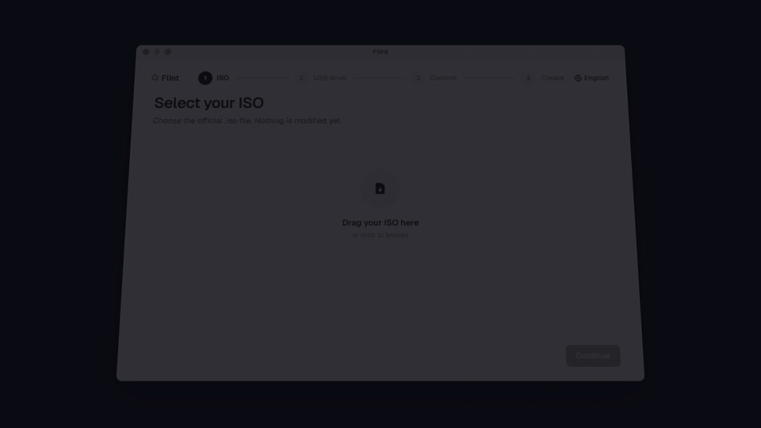

<p align="center">
  
</p>

<h1 align="center">Flint</h1>

<p align="center">
  Make a bootable Windows or Linux USB on your Mac, without risking the wrong disk.<br>
  Free, open source, and your Mac's internal disk never shows up in its drive list.
</p>

<p align="center">
  <a href="https://github.com/ohernandezdev/flint/releases/latest"><b>Download for Mac</b></a>
  &nbsp;·&nbsp;
  <a href="https://ohernandezdev.github.io/flint/">Website</a>
  &nbsp;·&nbsp;
  <a href="https://ohernandezdev.github.io/flint/#film">30-second film</a>
</p>

<p align="center">
  <a href="https://github.com/ohernandezdev/flint/releases/latest"></a>
  <a href="https://github.com/ohernandezdev/flint/releases"></a>
  
  <a href="LICENSE"></a>
</p>

<p align="center">
  
</p>

## Why I built this

I bought parts for a new PC and needed a Windows installer on a USB stick. All I had was a Mac. The options were paying for one of the few apps that do this, or running an unsigned binary from a site I'd never heard of, as root, pointed at my disks. Neither felt right, so I wrote the one I wanted and made it free.

I built it alongside an AI coding agent. That's what made it realistic for one person to ship it with tests, a properly isolated privileged helper and a notarized release.

## Download

1. Grab `Flint-1.0.0.dmg` from the [latest release](https://github.com/ohernandezdev/flint/releases/latest). It's signed and notarized, about 1.6 MB.
2. Drag **Flint** into Applications and open it.
3. The first time, macOS asks you to allow Flint's helper in **System Settings → General → Login Items**. That helper is the small root process that erases the drive and writes the image. The [safety model](#safety-model) explains why it exists.

Requirements: macOS 13 (Ventura) or later, and a USB stick you don't mind erasing: 16 GB for Windows 11 (Flint warns below that), or at least the size of the ISO for Linux.

> [!NOTE]
> **Intel Macs:** Linux images work. Windows ISOs whose `install.wim` is over 4 GiB (current Windows 11 images) need an Apple Silicon Mac for now: the `wimlib` tool bundled in v1.0.0 is arm64-only, so on an Intel Mac the build fails at the split step, **after the drive has been erased**. A universal wimlib build would fix it, see [Contributing](#contributing).

## What it does

- **Works out what kind of ISO you gave it.** Flint reads the boot records (MBR signature and El Torito) and picks a method:
  - **Windows installers** are copied to a fresh FAT32 / GPT drive. `sources/install.wim` is split into `.swm` pieces of 3800 MiB with [wimlib](https://wimlib.net) so it fits FAT32's 4 GiB limit. Windows Setup puts them back together on its own.
  - **Linux and other isohybrid ISOs** (Ubuntu, Fedora, Debian, …) are written raw, byte for byte, the way their makers ship them.
  - ISOs it can't make bootable are turned away before anything is written.
- **Never lists your internal disk.** The drive picker only shows external, physical, removable or ejectable disks. Your Mac's internal disk isn't hidden by a filter you could click past, it never makes it into the list. Other external drives (a backup disk, say) can appear, so unplug the ones you care about.
- **Checks the SHA-256 if you ask.** Paste the hash from the download page and Flint checks the file against it and tells you if it doesn't match.
- **Won't start a write it can't finish.** For raw writes it checks the stick is at least as big as the ISO first.
- **Warns about Secure Boot.** If a Windows ISO's boot files predate mid-2024, they were likely signed only with Microsoft's 2011 certificate and may not boot with Secure Boot on; Flint warns you before you start.
- **Shows real progress.** Bytes, percent, MB/s and time left for every phase, the raw write included.
- **Speaks English and Spanish.**
- **Stays offline.** No account, no analytics, no network code.

## Safety model

Flint erases drives and runs a helper as root. That's the dangerous part, so these checks sit between you and the wrong disk.

| | Safeguard | What it means |
|---|---|---|
| S-1 | Only external drives get listed | `DiskFilter` / `DiskArbitrationSource` only surface whole disks that are external and removable or ejectable. The boot disk, mounted disk images, cryptexes and virtual devices (`busProtocol == "Disk Image"`, `Virtual`) are dropped in code. The filter doesn't require the USB bus, so other external drives can appear. |
| S-2 | You confirm by name and size | The confirm screen shows the exact drive name and size, and the erase button stays off until you tick "I understand". |
| S-3 | Checked again right before writing | The disk identifier is re-validated immediately before the write, not just when you picked it. |
| S-4 | The helper double-checks | The root helper independently checks that its target is external and removable. It doesn't take the app's word for it. |
| S-5 | Failures stop cleanly | If a step fails, the build stops and tells you instead of carrying on with a half-made drive. |

**Privilege isolation.** Only the steps that touch the disk itself run as root: `diskutil eraseDisk` (Windows flow), and for Linux images the unmount, the raw write to `/dev/rdiskN` and the eject. They live in `FlintHelper`, a minimal daemon registered with `SMAppService` and reached over XPC with a code-signature check on both sides. Copying, splitting and verifying run as you. There's no `AuthorizationExecuteWithPrivileges` anywhere.

Found a way around any of this? Please report it privately, see [SECURITY.md](SECURITY.md).

## FAQ

<details>
<summary><b>Can it erase my Mac's disk?</b></summary>

No. The drive list only contains external, physical, removable drives. Internal disks, disk images and virtual devices are filtered out in code, and the root helper checks the target again before it writes. Other external drives, like a backup disk, can show up, so unplug the ones you care about before you start.
</details>

<details>
<summary><b>Which ISOs work?</b></summary>

Windows installer ISOs are tested end to end: Windows 11 25H2, including a real install from the stick. Linux and other isohybrid ISOs (Ubuntu, Fedora, Debian, …) are written raw. The detector is tested against Ubuntu 26.04, but booting from a Flint-made Linux stick hasn't been confirmed on real hardware yet, so [reports are welcome](https://github.com/ohernandezdev/flint/issues). ISOs that can't be made bootable are rejected up front.

If the Linux ISO sits in a protected folder like Downloads, macOS may ask you to give the helper Full Disk Access; Flint links you straight to that setting.
</details>

<details>
<summary><b>Why not just use balenaEtcher, Boot Camp or Terminal?</b></summary>

| | Flint | balenaEtcher | WinDiskWriter | Boot Camp Assistant | Terminal (`diskutil` + `dd`) |
|---|:-:|:-:|:-:|:-:|:-:|
| Windows installer USB | ✓ | Writes it raw, won't boot | ✓ | Older Intel Macs only | Doable, with wimlib and care |
| Linux ISO USB | ✓ | ✓ | – | – | ✓ |
| Runs on Apple Silicon | ✓ | ✓ | ✓ | – | ✓ |
| Internal disk can't be picked | ✓ | Hidden by default | Didn't check | n/a | Up to you |
| Free and open source | ✓ | ✓ | ✓ | Free, closed source | Built in, free |

Etcher writes Windows ISOs as raw images, which don't boot on most PCs, and warns you about it. [WinDiskWriter](https://github.com/TechUnRestricted/WinDiskWriter) is a good Windows-only option. Boot Camp Assistant doesn't exist on Apple Silicon, and Intel Macs from 2015 on don't use a USB stick for it.
</details>

<details>
<summary><b>Does it phone home?</b></summary>

No. There's no account, no analytics and no network code in the app. It's GPLv3, so you can check.
</details>

## How it works

Flint inspects the ISO first, then runs one of two pipelines, both with live progress.

**Windows installers** (FAT32 copy), four phases:

1. **Format.** The root helper runs `diskutil eraseDisk` to lay down a fresh FAT32 / GPT layout, then the app mounts the new data partition.
2. **Copy.** Everything on the ISO is copied to the USB except `sources/install.wim`.
3. **Split.** If `install.wim` is over FAT32's 4 GiB limit, wimlib splits it into `install.swm`, `install2.swm`, … of at most 3800 MiB each. In testing, a 7.0 GB `install.wim` became three pieces (3.2 GB, 3.7 GB and 93 MB).
4. **Finish.** The volume is flushed and ejected.

**Linux / isohybrid ISOs** (raw write), one privileged phase:

1. **Write image.** After re-validating the target and checking the stick is big enough, the helper unmounts the whole disk, writes the ISO byte for byte to `/dev/rdiskN` (block-aligned, flushed with `DKIOCSYNCHRONIZECACHE`) and ejects it. No FAT32, no label, no split: the image already carries its own boot structure.

## Building from source

The repo doesn't commit an `.xcodeproj`; XcodeGen generates it from `project.yml`. You need Xcode 15+, [XcodeGen](https://github.com/yonaskolb/XcodeGen) and [wimlib](https://wimlib.net).

```bash
brew install xcodegen wimlib
scripts/package-wimlib.sh   # copies wimlib-imagex + libwim into App/Resources
xcodegen generate
open Flint.xcodeproj
```

For a signed local build that runs on real hardware (Developer ID), use `scripts/dogfood.sh`. It signs the app and re-signs the helper with the right identifier (`com.omarhernandez.flint.helper`). [docs/DOGFOODING.md](docs/DOGFOODING.md) covers the gotchas with `SMAppService`, XPC and the on-demand daemon.

Releases are built, signed, notarized and stapled by [`.github/workflows/release.yml`](.github/workflows/release.yml); `scripts/build-notarize.sh` is the local equivalent.

## Contributing

Issues and pull requests are welcome. Read [CONTRIBUTING.md](CONTRIBUTING.md) first. Good places to start:

- **Intel support for Windows ISOs.** Bundle a universal (`arm64` + `x86_64`) `wimlib-imagex` and `libwim` in `scripts/package-wimlib.sh` / the release workflow, and refuse to erase on Intel until then.
- **Linux on real hardware.** Make a Linux stick with Flint, boot a PC from it and report back; that path hasn't been confirmed on hardware yet.
- **ISO reports.** Tried a distro or a Windows build? Open an issue saying whether it booted, on which Mac.
- **Translations.** Strings live in `App/Resources/Localizable.xcstrings`; adding a language is mostly filling in a column.

## License

GPLv3, see [LICENSE](LICENSE). It has to be: Flint bundles and distributes [wimlib](https://wimlib.net), which is GPLv3 too, so any redistribution must keep the source available under the same terms.

## Acknowledgements

- [wimlib](https://wimlib.net), which makes FAT32-safe `install.wim` splitting possible.
- [Vercel's Geist design system](https://vercel.com/geist), the reference for the app's look (the internal token API keeps the historical `Carbon` name).
